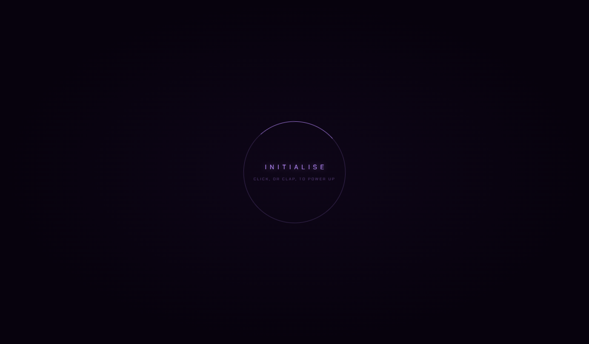

# Venom OS

## Start here

A voice assistant in Google Chrome that hands work to a team of agents run by
Hermes (a separate open-source program; the setup offers to install it).
You need Windows 11, Node.js 22.12 or newer, Git, Google Chrome, PowerShell 7
or Git for Windows, Claude Code installed and signed in (the talking interface
always runs on it) and access to an AI model for the agent team.

```sh
git clone https://github.com/venomgaminguae/venom-os.git
cd venom-os
npm ci          # took under a minute on a fast connection
npm run setup   # about ten questions; the Hermes download was not timed
npm start       # then open the printed address in Chrome
```

The wizard offers to install Hermes if missing and runs its health check, asks
which brain (GPT, Claude, Gemini or a local model), a subscription sign-in or
an API key (it opens the key file in Notepad) and a supervisor name, creates
the supervisor and the starter agents you pick, runs a link test (add your own
later with `npm run add-agent`). A sign-in uses your plan; API keys are billed
per use, apart from any subscription. ChatGPT sign-in is available; Claude
needs a Claude Max plan with purchased extra-usage credits (Claude Pro cannot:
use a key); Gemini is API key only ([providers]). Tested against a stand-in
for Hermes, not yet by a first real user. Everything else is reference, below.

Venom OS is a voice assistant (it calls itself VENOM) that runs in Google
Chrome behind a holographic heads-up display built with Vite, React and
three.js. It has two parts, and only one of them follows the AI model you
choose:

- The agent team follows your choice. Through a "team connector" MCP server
  (`hermes-mcp/`) VENOM hands longer jobs to a team of Hermes profiles: the
  starter specialists you pick at setup (researcher, coder, operator, writer)
  and any you add, with their workers, and a supervisor that delegates to
  them from Hermes, plus optional Claude Code and Google Antigravity bridges.
  Hermes profiles run on the brain you pick in `npm run setup`: OpenAI GPT,
  Anthropic Claude, Google Gemini, or a local model (Ollama or LM Studio).
- The voice app does not. Its local Node bridge (`bridge/server.mjs`) is built
  on the Claude Agent SDK, so it always runs on your own Claude Code login,
  whatever brain you chose for the team. See
  [Other brains in the voice app](#other-brains-in-the-voice-app-what-it-would-take)
  for what changing that would take.

Speech in and out can run on your own machine (Kokoro voice, local Whisper),
with the browser's own speech as the fallback.

Venom OS is a fork of [adewaskar/jarvis](https://github.com/adewaskar/jarvis)
by Aditya Dewaskar, released under the MIT licence. See
[Licence and credits](#licence-and-credits).

## Status

This is a personal project made public, not a finished product. Verified:

- The unit test suite passes (see `npm test`).
- `npm run lint` and `npm run build` pass on this public copy.
- The voice and microphone paths have proof scripts
  (`scripts/voice-proof.mjs`, `scripts/mic-proof.mjs`). They were run on one
  Windows 11 machine with Google Chrome, and nowhere else.

- A clean clone of this public copy was taken through this README on that
  same machine (Node.js 24.14, npm 11): `npm ci`, `npm test`, `npm run lint`,
  `npm run build`, `npm run setup -- --check`, `npm run setup` without Hermes
  (the wizard as it was then: it stopped and printed the install command; it
  now asks whether to install, which has not been run) and
  `npm run app:build`. The
  built desktop app was then started with `scripts/app-proof.mjs` (muted, test
  ports, its own profile, a stand-in for Claude Code): the window opened and
  showed the start screen below, the bridge started read-only, a second start
  exited by itself, and closing the window left no process. The `.exe`
  carries the placeholder icon, and the packaged bridge read the name, company
  and city from a `venom.config.json` placed in the clone before the build.



Not verified, or missing:

- Nobody has held a conversation with this public copy. INITIALISE, the
  microphone, hearing, the voice and a real Claude Code session were not
  tried in it, in Chrome or in the desktop app.
- The `npm run setup` wizard has not been run against real provider accounts
  (OpenAI, Anthropic, Google) or a real Hermes installation. Its tests use a
  stub Hermes.
- The new setup steps (offering to install Hermes, its health check, the
  sign-in or API-key choice with the `.env` step, the link test) are covered
  by unit tests against a stand-in Hermes and a stand-in editor
  (`scripts/fake-hermes.mjs`, `scripts/fake-editor.mjs`). Neither the real
  Hermes installer nor a real first-time setup has been run.
- The `hermes-setup/` scripts were tested end to end only against a stub
  Hermes (`scripts/fake-hermes.mjs`), not against a real Hermes installation.
- Telegram goes through Hermes's own gateway and is not exercised here.
- The desktop app was built and started once, on one machine, as described
  above. Not tried in the built app: everything after the start screen, the
  tray menu, the Desktop shortcut, `VENOM_ALLOW_WRITES=1`, and a PC other
  than the one that built it.
- No installer (run it from a clone, or build the portable app folder).
- Linux and macOS are untested; the launchers (`Venom.cmd`, `Venom.vbs`,
  `venom-app.ps1`) and several defaults are Windows only.

Features by test coverage (whether a test file in `test/` exists for it):

| Feature | State |
|---|---|
| Tool permission policy (`bridge/policy.mjs`) | Implemented, covered by unit tests |
| Bridge network binding, host and origin checks | Implemented, covered by unit tests |
| MCP server allowlist (`VENOM_MCP_SERVERS`) | Implemented, covered by unit tests |
| Memory (shared notes, conversation log) and owner name/company/city config | Implemented, covered by unit tests |
| Voice app model setting (`bridge/settings.mjs`: `VENOM_MODEL`, `appModel`) | Implemented, covered by unit tests |
| Team connector: roster, runner arguments, Claude Code deny list | Implemented, covered by unit tests |
| Agent activity log, run files, tiles, orbs, `/team` endpoints | Implemented, covered by unit tests |
| Local Whisper transcriber (worker lifecycle, with a fake worker) | Implemented, covered by unit tests; the real-model and Kokoro to Whisper round-trip tests are skipped without the models |
| Kokoro rest and fallback rules (`voicePolicy.ts`) | Implemented, covered by unit tests |
| Kokoro and system voice playback themselves | Implemented, not covered by unit tests (voice proof script only) |
| Speech chunker, interruption memory, hearing rules, wake phrase matching, microphone choice rules | Implemented, covered by unit tests |
| App window opener (`scripts/open-window.mjs`) | Implemented, covered by unit tests |
| Voice activity detection (`vad.ts`), clap to start (`clap.ts`) | Implemented, not covered by tests |
| Hand tracking (`hands.ts`) and camera (`camera.ts`, `bridge/vision.mjs`) | Implemented, not covered by tests |
| Control of your signed-in Chrome (`bridge/chrome.mjs`) | Implemented; only the WSL relay has a test, and it runs only under WSL |
| `npm run setup` wizard (`scripts/setup-lib.mjs`) | Implemented, covered by unit tests with a stubbed Hermes for all four brain choices (`test/setup-brain.test.mjs`; the tests that run the profile script are skipped without PowerShell 7 on Windows, or bash elsewhere). Not run against real provider accounts or a real Hermes install |
| `hermes-setup/` profile scripts | Implemented, tested end to end only against a stub Hermes (same test file) |
| Launchers (`Venom.cmd`, `Venom.vbs`, `venom-app.ps1`) | Implemented, not covered by tests |
| Desktop app rules and page server (`desktop/app-rules.mjs`, `desktop/static-server.mjs`) | Implemented, covered by unit tests |
| Desktop app shell and packaging (`desktop/main.mjs`, `scripts/build-app.mjs`) | Implemented, not covered by unit tests; built and started once from a clean clone (start screen only, see Status) |

## Requirements

- Windows 11 (other systems are untested), with PowerShell 7 (`pwsh.exe`) if
  you use `Venom.vbs`.
- Node.js 22.12 or newer, with npm. That is what the installed tools declare:
  the build tools (Vite, oxlint) want 20.19 or newer, or 22.12 or newer, and
  the desktop app tools (Electron, `@electron/packager`) want 22.12 or newer.
  Only Node.js 24.14 with npm 11 has been tried.
- Git, to clone.
- Disk space, measured on a clean clone: about 1.1 GB after `npm ci` (plus
  about 400 MB in npm's own cache), and about 2.2 GB after
  `npm run app:build` (the built app folder is about 900 MB of that), plus
  about 150 MB for the Electron download in `%LOCALAPPDATA%\electron\Cache`.
  The Kokoro voice (about 310 MB) and the Whisper model come on top.
- Google Chrome, in a real browser window. The launchers start Chrome only,
  never Edge. Embedded preview panes block the microphone.
- Claude Code, installed and signed in, for the voice app, whatever brain you
  choose for the team. Run `claude` once and complete the login. The bridge
  uses the Claude Agent SDK, which authenticates with that login: no Anthropic
  API key is needed, and usage counts against your own Claude account. The
  setup wizard reports whether Claude Code is installed and signed in, and
  runs without it; the Hermes team runs without it when you use Hermes
  directly; the voice app, and so reaching the team by voice, does not.
- Hermes Agent, for the agent team and for `npm run setup`. You need not
  install it first: if it is missing, the wizard shows the official install
  command and offers to run it. To install it by hand, see
  [hermes-setup/README.md](hermes-setup/README.md). The voice app alone runs
  with `npm start` without Hermes; it then has no team to hand jobs to.
- For the team's brain, one of: an OpenAI API key or ChatGPT subscription, an
  Anthropic API key or a Claude Max plan with purchased extra-usage credits, a
  Google Gemini API key, or Ollama or LM Studio running on this PC with a
  model downloaded. A subscription sign-in uses your plan; an API key is
  billed per use by the provider, separately from any subscription (see
  [Hermes's provider list][providers]). You sign in inside Hermes's own
  picker; an API key goes into the supervisor profile's `.env` file (see
  [Install and first run](#install-and-first-run)).
- PowerShell 7 (`pwsh`) or bash, which the wizard uses to run the
  `hermes-setup/` profile script.
- A GPU helps but is not strictly required:
  - The Kokoro voice runs in the browser on WebGPU. If it cannot load, the
    browser's built-in system voice speaks instead.
  - Local Whisper (optional) runs in the bridge on DirectML (GPU encoder, CPU
    decoder) by default and falls back to CPU on its own.
  - Hand tracking uses MediaPipe with the GPU delegate and retries on CPU if
    that fails.
- Optional:
  - an ElevenLabs API key, for an ElevenLabs voice and ElevenLabs Scribe
    transcription;
  - the Claude Code CLI (`claude` agent) and the Google Antigravity CLI
    (`agy`, `gemini` agent) as team members;
  - the Claude for Chrome extension, for control of your normal Chrome.

## Install and first run

```sh
git clone https://github.com/venomgaminguae/venom-os.git
cd venom-os
npm ci                    # or: npm install
npm run setup -- --check  # read-only look at this PC; changes nothing
npm start                 # the voice app alone; open the printed address in Chrome
```

That is enough for the voice app, if Claude Code is signed in. On a fast
connection `npm ci` took under a minute. It does not download the Electron
program: that comes with the first `npm run app` or `npm run app:build`.
npm reports a few known vulnerabilities in the dependencies when it finishes
(`npm audit` lists them); they have not been reviewed here.

For the agent team, run the wizard in a real terminal window (it refuses to
run through a pipe). Hermes Agent need not be installed first: the wizard
offers to install it.

```sh
npm run setup
```

`npm run setup` (`scripts/setup.mjs`, logic in `scripts/setup-lib.mjs`) is
interactive. In order, it:

1. Checks for Node.js 22.12 or newer and Google Chrome. If Hermes Agent is
   missing it shows the official install command (on Windows, in
   PowerShell: `iex (irm https://hermes-agent.nousresearch.com/install.ps1)`;
   guide:
   https://hermes-agent.nousresearch.com/docs/getting-started/installation),
   asks "Install Hermes now? (y/N)" and on yes runs it in the same window. A
   fresh install may not be visible in that terminal: if the wizard cannot
   find Hermes afterwards, it tells you to close the terminal, open a new one,
   go back to the folder and run `npm run setup` again (safe to repeat).
2. Runs Hermes's own health check, `hermes doctor`, and shows a pass, or the
   failing points with the fix Hermes suggests, then asks "Go on with setup?
   (y/N)". A model or key that is not set up yet is expected at this point.
3. Asks "Which brain do you want? 1) OpenAI GPT  2) Anthropic Claude
   3) Google Gemini  4) A local model on this PC (Ollama or LM Studio)".
   Right after, it reports whether Claude Code is installed and signed in.
   If you chose anything other than Claude, it says that the talking
   interface still needs Claude Code and asks "Go on, or stop here? (Y/n)".
   For a local model it asks Ollama (`OLLAMA_HOST`, default
   `http://localhost:11434`) and LM Studio (`http://localhost:1234`) which
   models are installed, lists them (with size where Ollama reports it), and
   warns that small models (roughly under 14B parameters or about 8 GB) are
   weak at tool use. If neither server answers it stops.
4. For GPT and Claude it says what each way means and what Hermes supports
   for that provider, then asks "How do you want to connect? 1) Sign in with
   my subscription  2) Paste an API key". A subscription sign-in uses your
   plan; an API key is billed per use by the provider, separately from any
   subscription. ChatGPT subscription sign-in is available. Claude sign-in
   needs a Claude Max plan with purchased extra-usage credits; with Claude
   Pro, use an API key. Gemini is API key only, so for Gemini there is no
   question. Source: [Hermes's provider list][providers]. Keys come from
   https://platform.openai.com/api-keys,
   https://console.anthropic.com/settings/keys and
   https://aistudio.google.com/apikey.
5. Asks "Name for the supervisor profile [venom]:". An existing profile is
   updated only if you say so. Then it asks about each of the four starter
   agents, one by one ("Researcher (...). Add it? (Y/n)"; Enter means yes,
   and you need at least one). If Claude Code or Antigravity is installed it
   also asks "Also add Claude Code as an agent (...)? (y/N)" (and the same
   for Gemini; Enter means no). On a later run it asks "Keep it on the team?
   (Y/n)" for agents already on the team, and agents you added yourself stay.
6. Sign-in route: opens Hermes's own model picker,
   `hermes -p <supervisor> model`, and you sign in there.
   API-key route: finds the variable name Hermes expects for that provider
   (from the installed Hermes's own provider list, else Hermes's
   documentation, else a built-in name, and says which), makes a dated backup
   of the supervisor profile's `.env` beside it, adds an empty `NAME=` line
   with a one-line instruction above it, and opens the file in Notepad
   (elsewhere `$VISUAL`, `$EDITOR`, nano or vi; `VENOM_SETUP_EDITOR` chooses
   another editor). You type the key after the `=`, save and close. Back in
   the wizard it checks, without printing the key, that the line is filled
   and has no quotes or spaces, and that no other line was lost: lines an
   editor dropped are put back from the backup and named. Then Hermes's
   picker opens so you pick the model.
   Either way the wizard reads back the provider and model and asks before
   keeping one from a different family.
7. Asks the model "Reply with the single word READY." and shows a pass or the
   real error (key-shaped text is masked), with the offer to open the file or
   the picker again.
8. Asks "Use a cheaper model for the workers? Type a model id from the same
   provider, or press Enter to use <MODEL_ID>:" (the brain's model) and tests
   a model id you type. Then asks "Add a fallback model for when the brain
   fails? (y/N)"; yes opens `hermes -p <supervisor> fallback add`. Then
   creates or updates the Hermes profiles (the supervisor plus the starter
   agents you chose) with
   `hermes-setup/create-profiles.ps1` (PowerShell 7) or
   `hermes-setup/create-profiles.sh` (bash), saves the team in
   `venom.agents.json`, and asks each agent the
   same test question. Account sign-ins are stored per profile and are not
   copied, so a failing agent gets its own fix command
   (`hermes -p <name> model`).
9. Runs a link test: through Hermes it asks the supervisor to hand one agent
   a one-line task through the team connector. It passes only if the agent's
   reply comes back and the run is recorded in the team activity log
   (`~/.venom/agents`). It prints `[link OK]` with the reply, or
   `[link FAILED]` with the real error and one fix command.
10. Asks "The voice app itself runs on Claude Code (see README). Claude model
    id for the voice app, or press Enter to use your Claude Code default:",
    writes `brain`, `worker`, `supervisorProfile` and `appModel` into
    `venom.config.json`, keeping any other keys there, and prints a summary.
    It ends with three steps: how to start, what you should see (the
    INITIALISE ring), and the three commands that change the team
    (`npm run add-agent`, `npm run agents`, `npm run remove-agent`).

On the API-key route the key is typed into the supervisor profile's own
`.env` file (the specialists are cloned from it, so the key is copied into
their profiles' `.env` files too). The wizard never prints, logs, copies or
sends the key itself. `HERMES_EXE` points the wizard at a Hermes that is not
on the PATH or in `%LOCALAPPDATA%\hermes\bin`.

It is safe to run again. `npm run setup -- --check` is the read-only
preflight instead: it changes nothing and always exits 0. It looks for
Node.js, the Claude Code command, `~/.claude.json` (it counts the MCP servers
there) and an ElevenLabs key; it does not look for Chrome or Hermes, which
only the wizard checks.
`npm run setup -- --no-alias` runs the wizard without Hermes's per-profile
commands.

Optional configuration (both files are git-ignored):

- Copy `.env.example` to `.env.local` for frontend settings (only `VITE_*`
  variables reach the browser). Bridge and connector variables are read from
  the environment of the shell that starts them, not from any `.env` file.
- `venom.config.json` (copy `venom.config.example.json`, or let
  `npm run setup` create it) holds your name, company and city (`ownerName`,
  `company`, `city`). Environment variables `VENOM_OWNER_NAME`,
  `VENOM_COMPANY` and `VENOM_CITY` take priority. With neither, VENOM uses
  neutral wording ("the owner"). The wizard adds `brain` and `worker`
  (provider and model of the team), `supervisorProfile` and `appModel`. The
  voice app reads only `appModel` of these (see
  [Voice app: Claude Code through the bridge](#voice-app-claude-code-through-the-bridge));
  the others record what setup chose.

Three ways to start it:

| Command | What it does |
|---|---|
| `npm start` | Starts the bridge and the Vite dev server together in this terminal, read-only. Open the printed URL in Chrome yourself. Ctrl-C stops both. |
| `Venom.cmd` | Runs `npm start -- --window` in a console window, read-only, with `VENOM_MCP_SERVERS` set if you have not set it (see below). |
| `Venom.vbs` | Runs `venom-app.ps1` with no console: starts the servers hidden, read-only, opens the app window, and stops the servers when that window closes. Logs go to `~/.venom/logs`. |

Flags for `npm start` (pass them after `--`, e.g. `npm start -- --writes`):

- `--writes` lets VENOM use effectful tools (shell, file writes, sending,
  clicking). Without it, and without `VENOM_ALLOW_WRITES=1` in the
  environment, the bridge is read-only. Read
  [Security notes](#security-notes) first.
- `--window` opens the app in its own Chrome window once both servers answer.

Both launchers start read-only. To let VENOM act, set `VENOM_ALLOW_WRITES=1`
in the environment before you start a launcher (for `Venom.vbs`, for example
as a user environment variable; the bridge reads it directly), or run
`npm start -- --writes` yourself. The launchers also clear `ANTHROPIC_API_KEY`,
`ANTHROPIC_BASE_URL` and `CLAUDECODE` (the PowerShell launcher clears every
`ANTHROPIC*` and `CLAUDE*` variable) so your own Claude Code login is used, and
they set `VENOM_MCP_SERVERS=hermes,context7,firecrawl,sequential-thinking`
unless it is already defined. Without the launchers every configured MCP
server is passed through. Neither launcher names a model; see
[Voice app: Claude Code through the bridge](#voice-app-claude-code-through-the-bridge).

Default ports: 5173 for the app (Vite), 8787 for the bridge. Change them with
`PORT` and `VENOM_BRIDGE_PORT` (and `VITE_BRIDGE_URL` to match).

In the app, click INITIALISE (or clap), allow the microphone, and say
"Hey Venom".

## Desktop app (Windows)

Venom OS can also run as a Windows desktop app with its own window, taskbar
icon and tray icon, beside the Chrome way above, which is unchanged. The shell
is Electron (`desktop/main.mjs`); the interface, the bridge, the voice, the
hearing and the agent team are the same code. From this public copy the app
has been built and started once, as far as the start screen (see
[Status](#status)).

What you must have before you build:

- Everything under [Requirements](#requirements), with `npm ci` done. Run
  `npm run setup` first if you want its settings in the app (see "Settings"
  below).
- Claude Code signed in on this PC (run `claude` once and complete the login).
  The packaged folder contains its own copy of the Claude Code program (the
  `@anthropic-ai/claude-agent-sdk-win32-x64` package that npm installs), so
  the app does not need `claude` on the PATH, but it uses the login that
  Claude Code stored for your Windows user. Every `ANTHROPIC*` and `CLAUDE*`
  variable is removed from the bridge's environment, so an API key is not used.
- The Whisper speech model, placed by you. Chrome's speech recognition does
  not exist outside Chrome, so the app always hears through local Whisper
  (`VENOM_LOCAL_STT=1`, wake route `local`). The model is not downloaded for
  you and is not copied into the app: put `onnx-community/whisper-base.en` in
  the transformers.js layout in `VENOM_STT_MODEL_DIR`, else `~/.venom/models`,
  else this project's `desktop/models` (see [Hearing](#hearing)). Without it
  the window still opens after about 20 seconds but cannot hear you.
- Node.js 22.12 or newer (what Electron and `@electron/packager` declare).
- About 1.1 GB of free disk space on top of the installed clone, and an
  internet connection for the first build: `@electron/packager` downloads the
  Electron runtime (about 150 MB) into `%LOCALAPPDATA%\electron\Cache` unless
  it is already there.

Build and start:

```sh
npm run app:build
"release\Venom OS-win32-x64\Venom OS.exe"
```

- `npm run app:build` (`scripts/build-app.mjs`) builds the interface, then
  packages `release/Venom OS-win32-x64/` (git-ignored). Measured on a clean
  clone: 902 MB in about 7,200 files, of which about 340 MB is the Claude
  Code program; the build took 15 seconds on a fast PC and connection,
  Electron download included. `npm run app` starts the app from the clone
  without packaging (it needs a built `dist/`: `npm run build` first, and it
  downloads Electron the first time; this way was not tried from this copy).
- Without the Whisper model the app waits about 20 seconds for it before the
  window opens.
- The folder is portable: there is no installer, no Start menu entry and no
  auto-update. Move or copy the whole folder, not only the `.exe`. The app is
  a copy of the code at build time: after changing the bridge, the interface
  or your settings, build again.
- `"Venom OS.exe" --make-shortcut` writes one Desktop shortcut,
  `Venom OS (app).lnk`, and nothing else.
- The app is not signed. On a PC other than the one that built it, Windows
  SmartScreen shows "Windows protected your PC"; choose More info, then Run
  anyway. Build it yourself rather than running a folder someone sent you.
- Do not pass the built folder on to others without checking Anthropic's
  terms: it contains Anthropic's proprietary Claude Code program.

How it behaves:

- It starts its own bridge on port 8788 (the Chrome way keeps 8787) and serves
  the built interface on `http://127.0.0.1:4188`. A taken bridge port is an
  error box naming the port; a taken page port moves to the next free one up
  to 4199 (saved choices and the voice cache belong to 4188 and start empty
  elsewhere). A second start shows the window that is already open. Closing
  the window, or Quit in the tray, stops the bridge and everything it started.
- Read-only by default, like the launchers. Set `VENOM_ALLOW_WRITES=1` in your
  environment before starting the app to let VENOM act (read
  [Security notes](#security-notes) first). `VENOM_MCP_SERVERS` is set to
  `hermes,context7,firecrawl,sequential-thinking` unless you define it.
- Settings: the build copies your `venom.config.json`, if there is one, into
  the app, so the name, company, city and `appModel` from `npm run setup`
  apply. Environment variables still take priority. No model is named
  otherwise: Claude Code uses its own default.
- Window: full screen. F11 leaves and re-enters; Esc stays "stand down".
  `VENOM_WINDOWED=1` gives a 1400x850 window.
- Tray icon: Show, Stand down, Start with Windows (off until you tick it; it
  adds one entry to your own Windows start-up list, and unticking removes it),
  Quit.
- Voice: Kokoro on WebGPU, as in Chrome; the model is downloaded once into the
  app's own profile. The fallback is an installed Windows voice.
- Microphone, camera and autoplay are granted to the app's own page only,
  with no prompt. Other permissions are refused, the page cannot navigate
  away, and outside links open in Google Chrome
  (`C:\Program Files\Google\Chrome\Application\chrome.exe`).
- Data: the bridge uses the same `~/.venom` folders as the Chrome way. The
  app's own profile is `~/.venom/desktop-app`, with `app.log` and `bridge.log`
  in its `logs` folder. The microphone chosen with M, the system voice chosen
  with V and the downloaded Kokoro model do not carry over from Chrome.
- Do not use the app and the Chrome way at the same time for real work: each
  has its own bridge, and both would write the same memory.

The icon is a placeholder drawn by `scripts/make-icon.mjs`
(`desktop/app-icon.ico`: a dark square with a cyan ring). To use your own,
replace `desktop/app-icon.ico` with any Windows `.ico` file that includes a
256 pixel image, then run `npm run app:build` again. The window, the tray, the
`.exe` and the shortcut all take it from there.

| Variable | Default | Effect |
|---|---|---|
| `VENOM_APP_BRIDGE_PORT` | `8788` | The app's bridge port |
| `VENOM_APP_PORT` | first free of `4188`-`4199` | The app's page port |
| `VENOM_APP_DATA` | `~/.venom/desktop-app` | The app's profile and logs |
| `VENOM_APP_DIST` | the packaged `dist` | Serve another built interface (proofs) |
| `VENOM_APP_NODE` | the app itself in Node mode | Run the bridge with this `node.exe` instead |
| `VENOM_APP_SILENT` | off | `1`: Chromium muted, every spoken sentence at volume 0, no error boxes (tests) |
| `VENOM_APP_CAPTURE` | off | with `VENOM_APP_SILENT=1` only: Chromium stays muted and system voices stay at volume 0, but the page's own audio graph is left live so `scripts/turn-proof.mjs` can record the spoken answer; no effect otherwise |
| `VENOM_WINDOWED` | off | `1`: a normal window instead of full screen |

`node scripts/app-proof.mjs` starts a packaged app silently on test ports
(4198, 8798) with a scratch profile (`--scratch <dir>`, by default a folder in
the system temp folder) and a fake brain, and checks the start, the bridge and
microphone, INITIALISE, F11 and Esc, a second start, and that closing leaves
nothing running. It opens a window. The rules are in `desktop/app-rules.mjs`
(`test/app-rules.test.mjs`) and the page server in `desktop/static-server.mjs`
(`test/static-server.test.mjs`).

## Connections

Every variable, with its default, is listed in [.env.example](.env.example).

### Voice app: Claude Code through the bridge

Required for the voice app, whatever brain the team uses. `bridge/server.mjs`
runs the Claude Agent SDK on your Claude Code login and talks to the page over
a WebSocket on `ws://localhost:8787`. It passes the MCP servers from your
`~/.claude.json` to the session, filtered by `VENOM_MCP_SERVERS`. Setup: sign
in to Claude Code, then start VENOM. Optional setting: `VENOM_EFFORT`.

Which Claude model the voice app uses (`bridge/settings.mjs`):

1. `VENOM_MODEL` in the bridge's environment, if set;
2. else `appModel` in `venom.config.json` (`npm run setup` asks for it);
3. else none: the bridge names no model and Claude Code uses its own default
   for your account. Your `/model` preference in Claude Code does not apply,
   because the bridge loads no Claude Code settings files.

A value that does not look like a model id is ignored with a warning, and the
next source is used. The bridge prints the model it uses when it starts.

A browser-only "direct" mode (`VITE_BACKEND=direct` with
`VITE_ANTHROPIC_API_KEY=<KEY>` and `VITE_ANTHROPIC_MODEL=<model-id>`; there is
no default model) exists, but that key ships to the browser.

### Team connector and Hermes

Optional for the voice app. `hermes-mcp/server.mjs` is a stdio MCP server with
one tool, `ask_agent(agent, task)`, used only when an MCP server named exactly
`hermes` in `~/.claude.json` points at it. Hermes Agent (open source, by Nous
Research) is not included; `npm run setup` creates the profiles, and the setup
kit is [hermes-setup/README.md](hermes-setup/README.md). The wizard also
registers the same server as `team` on the supervisor profile, so the
supervisor can delegate from Hermes itself. It does not register it for the
voice app; do that yourself:

```sh
claude mcp add --scope user hermes -- node "<REPO_PATH>/hermes-mcp/server.mjs"
```

### Voice out

- Kokoro (default): a neural voice that runs in the browser. The model
  (`onnx-community/Kokoro-82M-v1.0-ONNX`) is downloaded once from Hugging Face
  and cached by the browser. Settings: `VITE_KOKORO_VOICE`, `VITE_KOKORO_DTYPE`.
- System voice: the browser's `speechSynthesis`, only the fallback for a real
  Kokoro failure (the HUD line says so in amber or red). While the model loads
  VENOM waits instead: the boot screen stays on `voice loading` for up to 20 s
  more, and a sentence asked for during loading waits up to 20 s
  (`LOAD_WAIT_MS` in `src/lib/voicePolicy.ts`). A failed generation is tried
  once more. Slower than realtime no longer switches voices (it is counted as
  `slowStreaks` in the D panel's data). Kokoro rests for 45 s, with the system
  voice speaking, only after three failed generations in a row or a failed
  load, or if Kokoro cannot load. `VITE_TTS_ENGINE=system` uses it always. The
  V key cycles system voices.
- Between sentences: the next sentence is generated while the current one
  plays, including one that arrives during playback.
- ElevenLabs (optional): set `ELEVENLABS_API_KEY=<KEY>` in the bridge's
  environment, or have it in an `elevenlabs` MCP server entry in
  `~/.claude.json`. `VITE_USE_ELEVENLABS=true` prefers it in the browser.

### Hearing

- Browser recognition (default with no setup): Chrome's `SpeechRecognition`.
  Audio goes to Google.
- Local Whisper (optional): start the bridge with `VENOM_LOCAL_STT=1`. It runs
  `onnx-community/whisper-base.en` (English only) in a child process of the
  bridge (`bridge/stt-local.mjs`). The model files are not downloaded for you:
  place them in the transformers.js layout under `desktop/models/` (git-ignored)
  or point `VENOM_STT_MODEL_DIR` at your folder. After three local failures in
  a row the page falls back to Chrome for the rest of the session.
- With an ElevenLabs key, Scribe is used when local Whisper is off.
- `VITE_STT_ENGINE=browser` forces Chrome recognition.

### Wake word

The wake phrase is "Venom", optionally preceded by "hey", "hi", "ok", "okay",
"yo" or "hello" (`src/lib/wake.ts`). Common mis-hearings such as "Venum" or
"Phenom" also count anywhere. Wider ones that local Whisper has written
("Hey Vero", "Hey Venoms", "ven um", or "Hi Venom" run together) count only
right after a greeting or as the first word said. The D panel names the
spelling that matched. Detection is a text match on speech transcripts:

- with browser hearing, Chrome recognition provides them;
- with local Whisper, Chrome recognition listens while VENOM is dormant and
  Whisper checks dormant speech too (`VITE_WAKE_ROUTE=browser`, the default),
  or Whisper alone listens (`VITE_WAKE_ROUTE=local`, nothing goes to Google,
  slower to wake);
- with ElevenLabs hearing, Scribe transcripts are used.

There is no separate wake-word engine. Space starts a turn without the wake
word.

### Microphone

VENOM picks the input itself (`src/lib/audio.ts`, rules in
`src/lib/micPolicy.ts`): the one you saved with the M key, else the first input
whose name contains `VITE_MIC_PREFER` (only if you set it; there is no default
preference), else the loudest input over a short sample, else the first real
input. M cycles inputs and remembers the choice in the page's local storage.
A line above the footer names the input and shows its level. Chrome's own
recognition cannot be pointed at a device from the page, so with browser
hearing it uses whatever microphone Chrome ranks first.

### Memory

On by default (`VENOM_MEMORY=0` turns it off). Two parts (`bridge/memory.mjs`):

- Shared notes: `MEMORY.md` and `USER.md` in Hermes's memory folder
  (`%LOCALAPPDATA%\hermes\memories` by default, or `HERMES_HOME`, or
  `VENOM_HERMES_MEMORY_DIR`). Read into every new session. Saving, updating
  and forgetting need `--writes`.
- Conversation log: one line per finished turn, your words and VENOM's final
  answer only, in `~/.venom/memory/conversations/` (`VENOM_MEMORY_DIR`). Kept
  for `VENOM_MEMORY_DAYS` (365 by default). Searching it does not need
  `--writes`.

To wipe the log, stop the bridge and delete that folder.

Optional long-term memory through Honcho (`bridge/longmemory.mjs`,
`bridge/honcho.mjs`). Honcho is an outside service, not part of this project:
it needs its own account and API key, and its hosted service is paid (check
its current pricing; the bridge stops sending when the service says the
account is out of credits). It is off unless a key is found. When Honcho
refuses the key (401, 403) or the account is out of credits (402), the turns
are kept and tried again, and the memory section on the HUD
(`Honcho read-only N waiting`) and the bridge log say so; reading still works
then. When a key is
present, each finished spoken turn (your words and the part of VENOM's answer
that was spoken) is also sent, in the background, to a Honcho workspace (the
hosted service at `https://api.honcho.dev` by default, so your words leave
the machine), under one session a day named `venom-os-YYYY-MM-DD`; the
`memory_recall` tool sends your search text there and reads back matching
turns and Honcho's profile of the owner. The key is taken from
`VENOM_HONCHO_API_KEY` or `HONCHO_API_KEY`, or from Hermes's own `.env`: if
you already use Honcho in Hermes, VENOM turns it on by itself, and
`VENOM_HONCHO=0` keeps it off. Workspace and peer names come from
`VENOM_HONCHO_WORKSPACE`, `VENOM_HONCHO_AI_PEER` and `VENOM_HONCHO_USER_PEER`,
or Hermes's `honcho.json`, else `hermes`, `venom` and `owner`. It is off with
no key, with `VENOM_HONCHO=0` or with `VENOM_MEMORY=0`. Covered by unit tests against a fake server; in this public
copy it has never been run against the real service
(`node scripts/honcho-proof.mjs` does that with your own key).

**The memory section on the HUD.** Under the mic line, one line sums up every
memory source, for example `memory · Honcho 4 sent · notes 5 · skills 12 ·
vault not found · graph not found · log 9 · R details`. **R** opens one row
per source with its state, a count and when it last changed. The bridge
checks each one when the page asks (`GET /memory/sources`, every 30 s;
`bridge/memorysources.mjs`, `src/ui/MemoryStatus.tsx`, rules in
`src/lib/memoryLine.ts`). Status and counts only: no memory text, path, key or
error message is ever sent.

| Row | What is checked | States |
|---|---|---|
| Honcho | a live ping (at most one a minute) and the result of the last write | `connected`, `read-only` (answers, but writes are refused: out of credits or key refused; shows how many turns wait), `offline`, `off` |
| Hermes notes | `MEMORY.md` and `USER.md`: entries counted | `connected` with `--writes`, else `read-only`; `not found` |
| Agent skills | `SKILL.md` files under Hermes's `skills` folder and each profile's | `read-only`, `not found` |
| Obsidian vault | the notes beside `Home.md` in `VENOM_VAULT_DIR` (no default: unset means `not found`) | `read-only`, `not found` |
| Knowledge graph | `VENOM_GRAPH_FILE`, else this project's `graphify-out/graph.json`: nodes counted | `read-only`, `not found` |
| Conversation log | turns in `~/.venom/memory/conversations` | `connected`, `off` |

`connected` means the bridge reads and writes it now; `read-only` means it is
found and readable and the app does not (or cannot) write it. Only Honcho's
`read-only` is a fault (amber). The skills are counted under
`VENOM_HERMES_ROOT`, by default the Hermes root derived from `HERMES_HOME` (a
profile's home points two levels up), else `%LOCALAPPDATA%\hermes`. A bridge
older than this shows the old single Honcho line.

### Telegram

Not part of this repository: Hermes's own gateway, step 9 of
[hermes-setup/README.md](hermes-setup/README.md).

### Chrome

- App window: `--window`, `Venom.cmd` and `Venom.vbs` open the app in Google
  Chrome with `--app`, full screen, on a separate profile in
  `~/.venom/chrome-app`, so it does not collide with your normal Chrome. A
  second start does not open a second window. `VENOM_WINDOWED=1` gives a normal
  1400x850 window.
- Your own Chrome: the bridge can drive your normal, signed-in Chrome through
  the Claude for Chrome extension's native host (`bridge/chrome.mjs`). Reading
  works read-only; clicking and typing need `--writes`. Leave it out with
  `VENOM_DISABLE=browser`.

### Hand tracking and camera

Off until you press G. The camera then turns on, and MediaPipe tracks your
hands in the browser. The WASM runtime is copied from `node_modules` into
`public/mediapipe/` by `npm start`; the hand model is fetched from Google's
storage at run time. Frames are not stored.

The agent also has camera tools (`bridge/vision.mjs`): a frame, or a few
seconds of frames as a grid, when you ask it to look. They need the page's
camera permission, show an indicator, and `VENOM_DISABLE=camera` removes them.

## Controls

| Input | Does |
|---|---|
| "Hey Venom" (or "Venom") | Wake it |
| Space | Talk without the wake word; on the start screen, power up (as do clicking INITIALISE and clapping); while it answers, interrupt |
| Speaking while it talks | Interrupts it (barge-in) |
| Esc | Stand down; with an agent's full view open, close that view instead |
| M | Next microphone (remembered) |
| V | Next system voice |
| T | Speak a fixed audio test line |
| D | Diagnostics panel |
| R | Memory section: one row per memory source, or back to the one-line summary |
| A | Show or hide the agent tiles |
| G | Camera and hand tracking on or off |
| F | Full screen on or off (in a normal window or tab) |
| F11 | Leave or re-enter the full screen the launchers open |
| E, X, `[`, `]` | While panels are open: expand, close, previous, next panel |
| PageUp, PageDown | Scroll an agent's full view |
| Click an agent tile or orb | Open that agent's full view (all runs, full results) |

Hand gestures, once G is on:

| Gesture | Does |
|---|---|
| Point | Move the cursor |
| Pinch | Grab a panel, move it, press |
| Open hand | Let go |
| Two fingers up (peace sign), moved up or down | Scroll |
| Two L-shaped hands | Resize |

## The team and how to add an agent

The team is a file you own: `venom.agents.json` in this folder (not stored in
git; `venom.agents.example.json` shows the format). Without it the four
starter agents are used. `npm run setup` asks which of them to create
(on a first run Enter means yes; at least one):

| id | Name | What it does |
|---|---|---|
| `researcher` | Researcher | Web research with links |
| `coder` | Coder | Writes, fixes, reviews and runs code |
| `operator` | Operator | Files, documents and routine tasks on this PC |
| `writer` | Writer | Drafts only, never sends |

Each runs on its own Hermes profile of the same name. If Claude Code or
Google Antigravity is installed, setup also offers `claude` (Claude Code) and
`gemini` (Gemini through Antigravity, read-only) as agents (Enter means no).
These two are not Hermes profiles: the team connector runs their programs
directly. Runs are logged in `~/.venom/agents` and shown as HUD tiles.

To change the team later, run one of these in a terminal window, then restart
Venom OS (the app reads the team once, when it starts):

| Command | What it does |
|---|---|
| `npm run add-agent` | Adds your own agent: a name, its job in your own words, and whether it is a general specialist or tied to one project folder |
| `npm run agents` | Shows the team and whether each agent answers (`npm run agents -- --quick` skips the question) |
| `npm run remove-agent` | Takes an agent off the team; asks separately before deleting its Hermes profile |

The HUD is tested with up to 12 agents; more work, but the team dock may get
crowded. A worked example, the file format and what to do when something goes
wrong are in [docs/adding-an-agent.md](docs/adding-an-agent.md).

## Other brains in the voice app: what it would take

`npm run setup` changes the brain of the Hermes team only. The voice app is
built on the Claude Agent SDK, and running it on GPT, Gemini or a local model
would need at least:

- replacing the SDK's `query` loop in `bridge/server.mjs` with a
  provider-neutral agent loop, or routing each turn through `hermes chat`;
- re-hosting the in-process SDK MCP tool servers (made with
  `createSdkMcpServer` in `bridge/chrome.mjs`, `bridge/longmemory.mjs`,
  `bridge/memory.mjs`, `bridge/panels.mjs`, `bridge/ui.mjs` and
  `bridge/vision.mjs`) as standalone MCP servers;
- re-implementing the tool permission gate: `bridge/policy.mjs` is enforced
  today through the SDK's `PreToolUse` hook and `canUseTool` callback in
  `bridge/server.mjs`;
- re-implementing streaming of partial answers (`includePartialMessages`) and
  interruption (`session.interrupt()`) on the new loop;
- measuring voice latency again.

None of this is done.

## Security notes

VENOM runs on your PC with your user account. What it may do:

- Read-only by default. Without `--writes` (or `VENOM_ALLOW_WRITES=1`) the
  agent has no shell and no file writes. MCP tools run only if their server is
  on a read-only list or their names start with a read verb; names with an
  effectful verb (send, delete, install, pay and so on) are refused
  (`decideTool` in `bridge/policy.mjs`). A `PreToolUse` hook applies this to
  every call, and `settingSources: []` stops other Claude Code settings from
  overriding it.
- You turn writes on yourself, with `npm start -- --writes`,
  `npm run bridge:writes` or `VENOM_ALLOW_WRITES=1` in the environment. The
  launchers `Venom.cmd` and `Venom.vbs` start read-only and only pass on a
  `VENOM_ALLOW_WRITES` you have set. With writes on the agent gets `Bash`,
  `Write`, `Edit` and `NotebookEdit`, effectful MCP tools, the acting Chrome
  tools and memory writes. The shell can reach anything your account can.
- File tools are confined to the workspace (`~/.venom/workspace`, or
  `VENOM_WORKSPACE`), the system temp folder and `VENOM_FILE_ROOTS`.
  Credential locations such as `~/.ssh`, `~/.claude` and `.env` files are
  refused even there.
- Every MCP server in `~/.claude.json` is passed to the agent unless you set
  `VENOM_MCP_SERVERS`. claude.ai account connectors stay out unless
  `VENOM_ACCOUNT_CONNECTORS=1`.
- The camera tools are not gated by `--writes`; they rely on the browser's
  camera permission and an on-screen indicator.
- The bridge binds to `127.0.0.1`, answers only requests addressed to
  `localhost`, `127.0.0.1` or `[::1]` (plus `VENOM_ALLOWED_HOSTS`), and accepts
  WebSocket connections only from local dev origins (ports 5173-5199 and
  4173-4199, plus `VENOM_ALLOWED_ORIGINS`). Clients with no `Origin` header are
  refused unless `VENOM_ALLOW_NO_ORIGIN=1`.
- The `claude` team agent runs Claude Code headless in `PROJECTS_ROOT`
  (default `~/Projects`) with `--permission-mode acceptEdits` and
  `--permission-prompts none`, a short allow list (web search and fetch,
  `git status|diff|log`, `npm test`, `npm run`, `npx tsc`, `node --check`,
  `node --test`, context7 and sequential-thinking) and a deny list in
  `hermes-mcp/runner.mjs`: `git push`, `git reset --hard`, `rm` with any
  option, `rmdir`, `del`, `Remove-Item`, every claude.ai account connector
  (one prefix rule, `mcp__claude_ai_*`, so connectors added later are refused
  too), and the GitHub, Linear and Playwright servers. `npm run` and
  `node --test` run code the agent can edit, so this is a guard rail, not a
  sandbox.
- The Hermes agents follow their own Hermes configuration and job briefs, not
  the bridge's policy.

How to restrict it further:

- Leave writes off: no `--writes` and no `VENOM_ALLOW_WRITES=1`.
- `VENOM_DISABLE=browser,camera,interface` removes those capabilities.
- `VENOM_MCP_SERVERS=<names>` passes only the servers you list (empty passes
  none).
- Keep `VENOM_FILE_ROOTS` unset or narrow, and `VENOM_BRIDGE_HOST` at its
  default.
- `VENOM_CLAUDE_EXECUTABLE=<path>` runs the agent through your own sandbox
  wrapper instead of the bundled CLI.

## Development

```sh
npm test          # Node's built-in test runner over test/
npm run lint      # oxlint
npm run build     # tsc -b && vite build
```

Where tests need the bridge they start it on random loopback ports with a fake
Claude CLI (`scripts/fake-cli.mjs`); no test opens a real agent session. The
setup wizard tests use a fake Hermes (`scripts/fake-hermes.mjs`) instead of a
real one.

Proof scripts (not in `npm test`; Chrome at its default Windows path; they
never use ports 5173 or 8787):

- `node scripts/voice-proof.mjs` starts its own bridge (fake CLI) and Vite
  servers on scratch ports and checks, in headless muted Chrome: Kokoro load
  and caching, time to first sound, chunking, fallback when the model is
  blocked or WebGPU is missing, interruption memory, that the test-only ask
  hook is absent from a normal page, and the "nothing can speak" alarm.
  `--real-profile` runs a headed, audible check on a copy of the app's Chrome
  profile; you need speakers.
- `node scripts/mic-proof.mjs` opens headed Chrome on a copy of the app's
  Chrome profile, lists every microphone with its measured level and shows
  which one the app's rules pick; you need a microphone.
- `node scripts/app-proof.mjs` and `node scripts/turn-proof.mjs` are for the
  desktop app (see [Desktop app](#desktop-app-windows)). `turn-proof.mjs`
  plays a WAV file as a fake microphone through one whole spoken turn and
  records the answer; it needs the Whisper model and has not been run from
  this public copy.
- `node scripts/speech-roundtrip.mjs` (Kokoro to local Whisper, needs the
  models) and `node hermes-mcp/selftest.mjs` (one task to one agent, needs
  Hermes) are smaller manual checks.

## Licence and credits

MIT, see [LICENSE](LICENSE).

- Original work: Copyright (c) 2026 Aditya Dewaskar,
  [adewaskar/jarvis](https://github.com/adewaskar/jarvis).
- Modifications in this fork are copyright their author and released under the
  same MIT licence.
- Music: three tracks by Kevin MacLeod (incompetech.com), CC BY 4.0. Titles
  and attribution text are in [public/audio/CREDITS.md](public/audio/CREDITS.md).
- Third-party assets, run-time models (Kokoro, Whisper, MediaPipe), fonts and
  npm dependency licences are listed in
  [THIRD-PARTY-NOTICES.md](THIRD-PARTY-NOTICES.md). In short: the Claude Agent
  SDK is proprietary Anthropic software installed from npm, Kokoro and Whisper
  weights are Apache-2.0 and downloaded, not committed, and a few items (the
  MediaPipe hand model, eSpeak NG inside phonemizer) have unconfirmed
  licences.
- Claude Code (Anthropic), Hermes Agent (Nous Research) and Google Antigravity
  are separate projects and are not included here.

[providers]: https://hermes-agent.nousresearch.com/docs/integrations/providers
